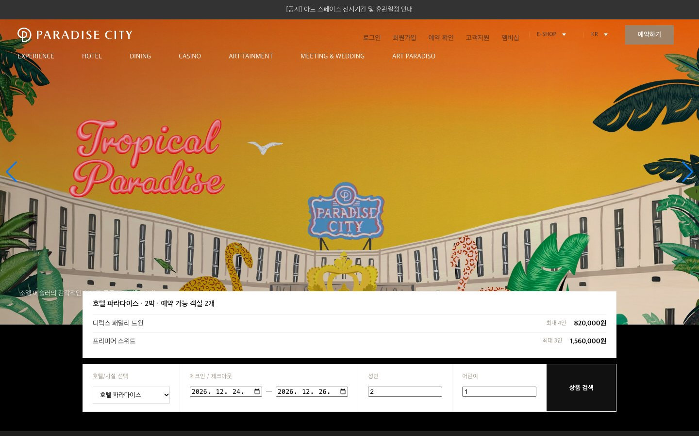

<div align="center">

# ☁️ Kakao Cloud 부트캠프

카카오 클라우드 부트캠프에서 공부한 **일자별 실습·과제**와 **클론 코딩 프로젝트**를 정리한 레포지토리입니다.

     
<br/>
      

</div>

---

## 🎠 대표 프로젝트 — [Paradise City 클론 코딩](CloneCoding)

<a href="CloneCoding"></a>

파라다이스시티 메인 페이지를 **React + TypeScript** 프런트와 **Node.js(Express) + TypeScript** API 서버로 클론 코딩한 풀스택 프로젝트

- 서버에서 받아오는 메인 슬라이더(이미지·영상), 입력값 검증과 숙박 요금 계산이 들어간 객실 검색 API
- `shared/types.ts`로 프런트·서버가 같은 API 타입을 공유, Vitest + Supertest/Testing Library 테스트 13개
- 데스크톱·모바일 반응형

👉 자세한 내용: [CloneCoding/README.md](CloneCoding/README.md)

---

## 📚 일자별 실습·과제 — [`HW/`](HW)

### 🌐 Frontend

| 날짜 | 주제 | 내용 |
|---|---|---|
| [8월 5일](HW/8월%205일) | HTML 마크업 | 사용자 정보 입력 폼, 시맨틱 태그로 편지 마크업 |
| [8월 6일](HW/8월%206일) | HTML / CSS | 회원가입 페이지, Biography 페이지 스타일링 |
| [8월 11일](HW/8월%2011일) | JavaScript | 이름 입력 반영·이미지 전환 등 첫 웹사이트 만들기 |
| [8월 14일](HW/8월%2014일) | React | props · state 예제 |

### 🐍 Python

| 날짜 | 주제 | 내용 |
|---|---|---|
| [8월 25일](HW/8월%2025일) | 객체 지향 | `Book` · `Library` · `Member` 도서관 관리 시스템 (SOLID, 캡슐화) |
| [8월 26일](HW/8월%2026일) | 파일 처리 · 예외 | 텍스트·CSV·JSON·바이너리 파일 처리기, 사용자 정의 예외 계층, 로깅 |
| [8월 27일](HW/8월%2027일) | 동시성 · 병렬처리 | 이터레이터·제너레이터, API 5개 요청을 순차 / ThreadPoolExecutor / asyncio+aiohttp 로 비교 → **0.81s → 0.36s → 0.17s** |
| [8월 28일](HW/8월%2028일) | 데이터 분석 | NumPy, Pandas (DataFrame, GroupBy, 상관관계·공분산, Merge) |

### 🤖 AI · ML/DL

| 날짜 | 주제 | 내용 |
|---|---|---|
| [9월 2일](HW/September/9월%202일) | ML 수학 · 컴퓨터비전 기초 | 이미지 데이터 처리, OpenCV |
| [9월 3일](HW/September/9월%203일) | 딥러닝 기초 | **과제**: 은닉층 없는 Softmax 분류기로 손글씨 숫자(load_digits) 분류, 역전파·경사하강 직접 구현 |
| [9월 5일](HW/September/9월%205일) | OCR | TrOCR 모델로 텍스트 인식 |
| [9월 8일](HW/September/9월%208일) | 객체 검출 · 세그멘테이션 · NLP | Mask R-CNN, YOLO, IoU·NMS, 챗봇 기초 |
| [9월 9일](HW/September/9월%209일) | LLM 챗봇 | OpenAI API로 함수 호출·대화 관리·에이전트 챗봇 (`OpenAIChatbot.py`) |

### ⚙️ Backend

| 날짜 | 주제 | 내용 |
|---|---|---|
| [9월 10일](HW/September/9월%2010일) | FastAPI | `APIRouter`로 To-Do List API |
| [9월 12일](HW/September/9월%2012일) | DB 연동 | SQL vs ORM(SQLAlchemy), PyMySQL로 INSERT·UPDATE·DELETE |

---

## 📁 구조

```
KakaoCloud
├── CloneCoding/        # Paradise City 클론 (client · server · shared)
└── HW/
    ├── 8월 5일 ~ 8월 28일   # Frontend · Python
    └── September/          # AI · ML/DL · Backend (9월 2일 ~ 9월 12일)
```

> `9월 9일` 챗봇 실습은 OpenAI API 키를 코드에 넣지 않고 `OPENAI_API_KEY` 환경변수에서 읽습니다.
